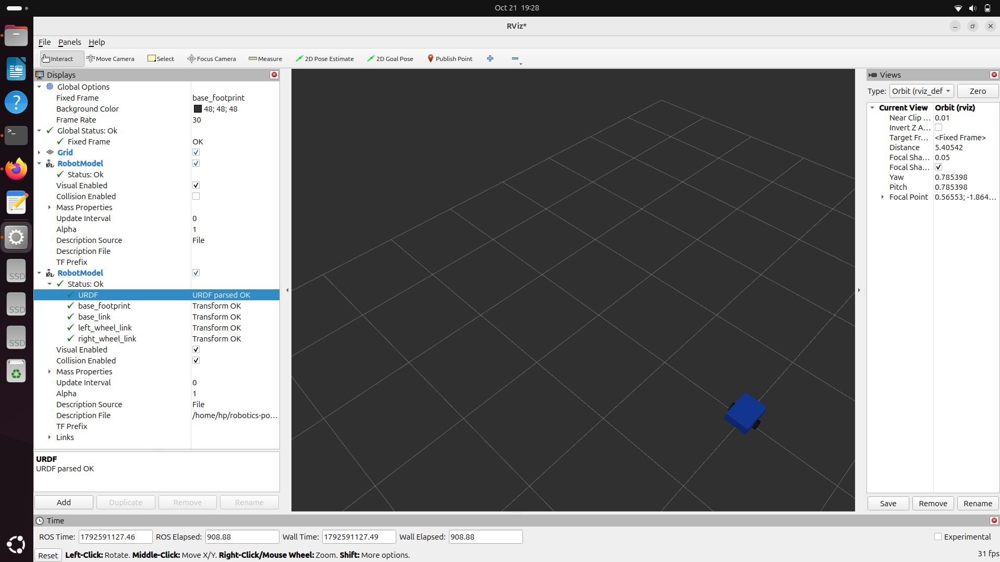

# ROS 2 Mobile Robot Simulation 🤖

A mobile robot modelling and simulation project built using **ROS 2 Jazzy, URDF, Xacro, and RViz2**. This project focuses on robot description, coordinate frames, joint states, and visualization, with Gazebo simulation and robot control planned as future improvements.

## 📌 Project Overview

The goal of this project is to develop a mobile robot model and gradually extend it with simulation, sensors, and autonomous navigation capabilities.

## 🛠️ Technologies Used

- Ubuntu 24.04 LTS
- ROS 2 Jazzy
- URDF and Xacro
- RViz2
- Python
- Git and GitHub

## ✨ Features

- Mobile robot modelling
- Robot description using URDF and Xacro
- Base link and wheel link definitions
- Robot visualization in RViz2
- ROS 2 launch file
- Joint-state and transform visualization
- Screenshot documentation

## 🖼️ Robot Visualization

The current robot model contains a base and two wheels, visualized in RViz2.



## 📂 Project Structure

```text
ros2-mobile-robot/
├── config/
├── description/
│   ├── mobile_robot.urdf
│   └── mobile_robot.urdf.xacro
├── launch/
│   └── display_robot.launch.py
├── meshes/
├── screenshots/
│   └── mobile_robot_rviz.png
├── worlds/
└── README.md
```

## ⚙️ Requirements

- Ubuntu 24.04 LTS
- ROS 2 Jazzy
- RViz2
- Xacro
- Robot State Publisher
- Joint State Publisher

## 🚀 Run the Robot Model

### 1. Source ROS 2

```bash
source /opt/ros/jazzy/setup.bash
```

### 2. Navigate to the project

```bash
cd ~/robotics-portfolio/ros2-mobile-robot
```

### 3. Generate the URDF file

```bash
ros2 run xacro xacro description/mobile_robot.urdf.xacro -o description/mobile_robot.urdf
```

### 4. Launch the robot state publisher

Open a terminal and run:

```bash
source /opt/ros/jazzy/setup.bash
ros2 run robot_state_publisher robot_state_publisher ~/robotics-portfolio/ros2-mobile-robot/description/mobile_robot.urdf
```

### 5. Start the joint-state publisher

Open another terminal and run:

```bash
source /opt/ros/jazzy/setup.bash
ros2 run joint_state_publisher joint_state_publisher
```

### 6. Open RViz2

Open a third terminal and run:

```bash
source /opt/ros/jazzy/setup.bash
ros2 run rviz2 rviz2
```

In RViz2, set the Fixed Frame to `base_footprint`, add a RobotModel display, and load the robot URDF file through its Description File property.

## 🔭 Future Improvements

- Configure robot movement and control
- Add Gazebo Harmonic simulation
- Integrate LiDAR sensors
- Implement obstacle detection and avoidance
- Explore SLAM and autonomous navigation
- Add simulation videos and test results

## 👩‍💻 Author

**Annika Bathula**  
Robotics and Automation Engineering

GitHub: [annikabathula2006](https://github.com/annikabathula2006)
